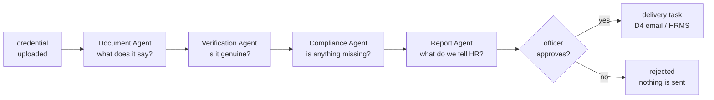
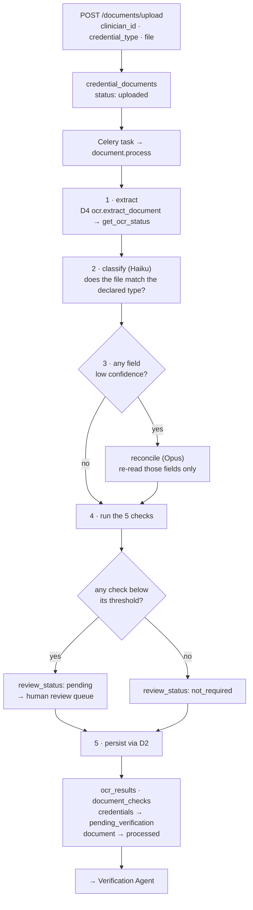
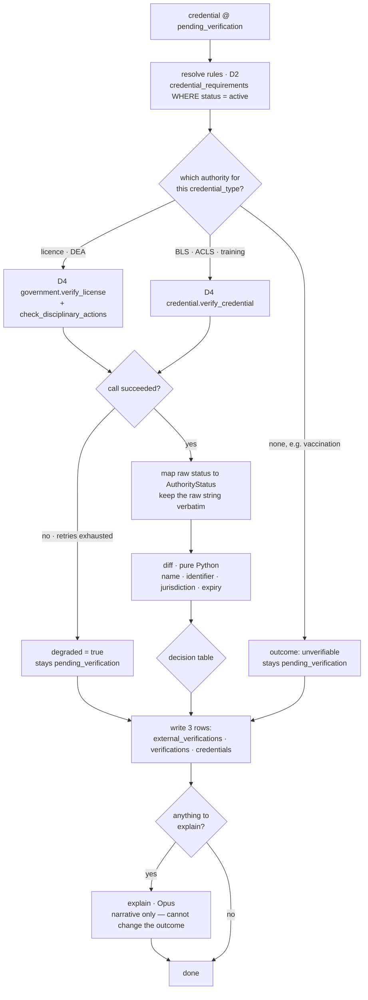
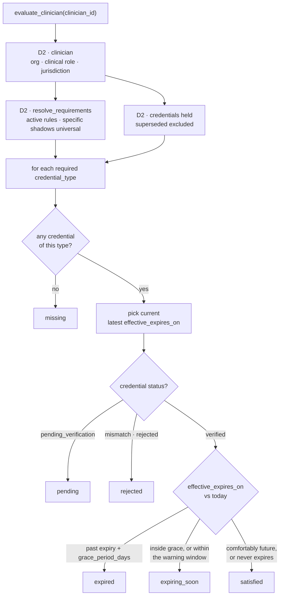
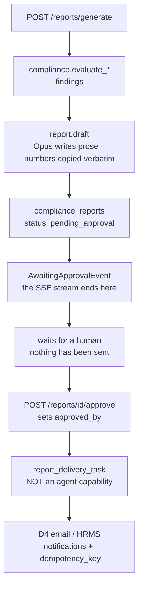
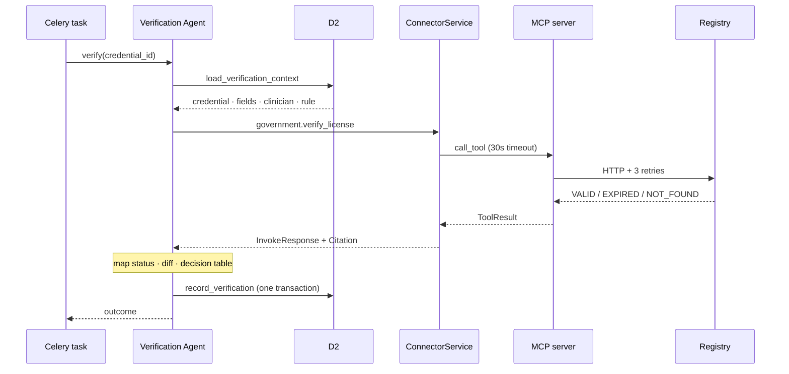

# D3 Agents — what each one does and what it must never do

The orchestrator (D3) owns four agents. Each is a unit of work behind the shared `invoke`
contract, addressed as `"<agent>.<capability>"` — the same shape D4 uses for
`"<connector>.<tool>"`.

Two rules hold for all four:

- **An agent never holds a database session.** It returns a structured result and persists through
  `D2.invoke(action="record_…")`. [architecture.md](../architecture.md) §7 allows `db/models` to be
  imported read-only outside the owning domain; writes go through the owning domain.
- **An agent never calls MCP directly.** External calls go through `D4.invoke`, so every one of them
  still passes D5's audit and RBAC wrapper.

---

## 1. The four agents at a glance



| Agent | Question it answers | Uses an LLM? | May call | Never |
|---|---|---|---|---|
| **Document** | "What does this file say?" | Yes — cheap classify, strong reconcile | D2, D4 | Verify against a registry · decide compliance · send |
| **Verification** | "Is this credential genuine and active?" | Only to narrate a mismatch | D2, D4 | Call D1 · decide org-wide compliance · send |
| **Compliance** | "Does this clinician hold everything required?" | **No** | D2 | Call D4 · read a document · any external API |
| **Report** | "What do we tell HR?" | Yes — prose only | D2, Compliance | **Send** · recompute compliance |

The `never` column is not documentation. Each capability declares `calls: tuple[str, ...]` on its
`CapabilityDef`, and `BaseAgent` raises if a capability reaches for a domain it did not declare.

**Why three of the four are mostly deterministic:** a compliance answer has to be defensible months
after it was given, which means the same inputs must produce the same answer every time. So the
Compliance Agent is pure SQL, and the Verification Agent's field diff is pure Python. The model's
job in those two is to *explain* a result it did not compute.

---

## 2. Document Agent

### What it does

Turns an uploaded file into two records:

1. **What the document says** — `ocr_results`, plus a `document_checks` row per quality signal.
2. **A draft credential** — a `credentials` row at `status='pending_verification'`.

It does not judge whether the credential is genuine. That is the Verification Agent's job, and
keeping the two apart is what lets the audit trail separate *what was claimed* from *what the
authority confirmed*.

The uploader declares `clinician_id` and `credential_type` on the request — HR knows what they are
uploading, and an authenticated human's assertion beats a model's guess. The agent's classification
therefore **corroborates** that declaration rather than overriding it.

### Flow



### Capabilities

| Capability | In | Out | Model | Calls |
|---|---|---|---|---|
| `extract` | `credential_document_id`, `storage_uri` | `fields{}`, `confidence`, `ocr_job_id` | none | D4 |
| `classify` | extracted text, `declared_credential_type` | `agrees`, `observed_type`, `confidence` | fast | — |
| `reconcile` | low-confidence `fields{}` | corrected `fields{}`, `per_field_confidence{}` | deep | — |
| `check` | `credential_document_id`, `fields{}` | `checks[]` | none | D4 |
| `process` | `credential_document_id` | `credential_draft{}`, `checks[]` | — | D2, D4 |

`process` is the composite the Celery task invokes; the other four are separately addressable so
they can be tested and replayed on their own.

**`process` is a LangGraph `StateGraph`** — the diagram above is its node graph, plus `load` and
`persist` at either end for the two D2 calls. Its nodes *wrap* the capabilities rather than
replacing them, which is what keeps each one individually invocable and keeps `CapabilityDef.calls`
enforced. The only conditional edge is the low-confidence branch into `reconcile`; whether a
credential row is built is a payload difference, decided inside `map_fields`. A node raising
`DomainError` propagates to `BaseAgent.run` and becomes `AgentResult(ok=False)`, exactly as a linear
call chain would.

There is no checkpointer. Resume-after-failure comes from Celery retry plus the idempotent writes in
`record_document_result`.

`reconcile` runs **only** on fields below the confidence floor. It is the one place a strong model
earns its cost: OCR reading `1` as `l` in a licence number is exactly what makes a later registry
lookup fail.

### The five checks

| Check | Decided by | Pending when |
|---|---|---|
| `ocr_quality` | OCR's own reported confidence | `< 0.75` |
| `type_match` | `classify` vs the declared `credential_type` | they disagree |
| `field_completeness` | required fields for that credential type | any missing after `reconcile` |
| `face_match` | `ocr.match_face` vs the clinician's stored identity document | `< 0.85` |
| `signature_detection` | `ocr.detect_signature` | not detected |

Thresholds are configuration, never literals in the agent.

Two rules that are easy to get wrong:

- **No identity document on file → `face_match` is `not_required`, not failed.** Absence of a
  comparison is not evidence of a mismatch.
- **`document_checks.passed` is nullable on purpose.** `NULL` with `review_status='pending'` means
  "no human has decided yet", which is not the same as `False`.

### Escalation

A pending check does **not** stop the pipeline. The credential is still created and still passed to
the Verification Agent; it simply stays out of compliance-satisfied counts until a human clears the
check. This is [PROJECT_OBJECTIVE.md](PROJECT_OBJECTIVE.md) §7 — *low confidence escalates, it does
not guess* — made concrete.

The pipeline stops in only two cases: OCR never completes within the poll budget (document →
`failed`), or tampering is detected (document → `quarantined`).

### Field mapping

| OCR field | Credential column |
|---|---|
| `provider_name` | `holder_name` |
| `license_number` | `identifier` |
| `issuer` | `jurisdiction` |
| `issue_date` | `issued_on` |
| `expiration_date` | `expires_on` |

`date_of_birth` is deliberately **not** copied onto `credentials`. It is PHI needed only for identity
matching, so it stays in `ocr_results.extracted_fields` behind D5's egress mask.

`effective_expires_on` is then derived: the printed `expires_on` when present, otherwise
`issued_on + renewal_months` from the matching active requirement — the case where a card prints no
expiry date at all. `expires_on` stays exactly as printed, so a disagreement between printed and
derived stays visible rather than being overwritten.

### Current state

Three of the five checks are live: `ocr_quality`, `type_match` and `field_completeness`.

`match_face` and `detect_signature` are **declared on the OCR connector but not implemented** — both
handlers answer `{"supported": false}`. No check row is raised from them, because a check nobody can
answer is noise in the review queue rather than safety. Wiring the two remaining checks is a small
addition once the handlers are real.

`type_match` only appears when a model tier is configured. Under `AGENT_TIER=deterministic` no
opinion is sought, so none is reported — an absent opinion is not a disagreement.

---

## 3. Verification Agent

### What it does

Answers one question about **one** credential: *is what this document claims what the issuing
authority actually says?*

It is the only agent that talks to an authoritative source, and it is deliberately the least
creative one in the system. The comparison it performs is pure Python. A model is used once, at the
very end, to write a sentence explaining a result it did not compute.

Three separate axes are recorded, and conflating them is the main thing to avoid:

| Axis | Column | Means |
|---|---|---|
| What the board said | `credentials.authority_status` (+ `authority_status_raw`) | Their word, canonical and verbatim |
| What the comparison found | `verifications.outcome` | Whether document and board agree |
| What we conclude | `credentials.status` | Our judgment, after policy is applied |

They can legitimately disagree. A credential whose fields match perfectly can still end at
`rejected` because the board says "probationary" and the organization's policy disallows it.

### Flow



### Capabilities

| Capability | In | Out | Model | Calls |
|---|---|---|---|---|
| `fetch_authority` | `credential_id`, `identifier`, `jurisdiction`, `credential_type` | `authority_status`, `authority_status_raw`, `record{}`, `degraded` | none | D4 |
| `diff` | extracted `fields{}`, authority `record{}` | `outcome`, `mismatches[]` | none | — |
| `explain` | `mismatches[]`, both records | `narrative` | deep | — |
| `verify` | `credential_id` | `outcome`, `mismatches[]`, `authority_status` | — | D2, D4 |

**`verify` is a LangGraph `StateGraph`**, built the same way `process` is: `load` and `persist` at
either end for the two D2 calls, and nodes that *wrap* the capabilities above rather than replacing
them, so each stays individually invocable with `CapabilityDef.calls` enforced. Two conditional
edges — into `diff`, which is skipped only when there is no record to compare against (no authority,
or an unreachable one; an *unreadable status* still diffs), and into `explain`, which runs only when
there is a mismatch or a policy objection to narrate. `decide` is a node of its own although it makes
no call: the decision table is the part an auditor asks about, and a graph showing fetch → diff →
persist would hide where the answer was made. No checkpointer, for the same reason as §2.

### Not every credential has an authority

A state medical board can confirm an RN licence. Nobody's registry holds a BLS card. The agent
therefore routes before it calls:

| Credential type | Authority | Tool |
|---|---|---|
| `rn_license`, `md_license`, `dea_registration` | Government registry | `government.verify_license` |
| `bls`, `acls`, `hipaa_training` | Credential library | `credential.verify_credential` |
| `vaccination`, `other` | none | — |

With no authority the outcome is `unverifiable` and the credential stays at
`pending_verification` — never `verified`. `VerificationOutcome.UNVERIFIABLE` exists for exactly
this case.

### Mapping the board's answer

The registry replies with its own vocabulary — `VALID`, `EXPIRED`, `SUSPENDED`, `NOT_FOUND`. That
string is stored verbatim in `authority_status_raw` and *also* mapped onto `AuthorityStatus`:

| Raw | Canonical |
|---|---|
| `VALID` | `active` |
| `EXPIRED` | `expired` |
| `SUSPENDED` | `suspended` |
| `NOT_FOUND` | `not_found` |
| anything unrecognized | `unchecked` + `degraded = true` |

**The last row is the important one.** A board that starts returning a status string we have never
seen must not be silently mapped to the nearest friendly value — mapping an unknown to `active` is a
compliance failure that would never surface. Unknown means we did not determine the status, and the
verbatim string is preserved so a human can see exactly what was said. This is why the ERD delta
added `authority_status_raw` alongside the enum.

### The diff

Extracted document fields versus the authoritative record. Rules are **not** an operand here.

| Field | From document | From authority | Compared |
|---|---|---|---|
| Holder name | `holder_name` | `provider_name` | normalized, then first + last token |
| Identifier | `identifier` | `license_number` | exact, after trim and upper-case |
| Jurisdiction | `jurisdiction` | `jurisdiction` | exact |
| Expiry | `expires_on` | `expiration_date` | exact date |

Name normalization strips titles and suffixes (`Dr.`, `MD`, `RN`), punctuation and extra whitespace,
then requires first and last token to match. It goes **no further than that** — no fuzzy or edit-
distance matching. A name that still does not match is a mismatch for a human to look at. Silently
accepting near-misses is how a wrong person's licence gets attached to a clinician.

### The decision table

Evaluated in order; the first match wins.

| Condition | `outcome` | `credentials.status` |
|---|---|---|
| No authority exists for this credential type | `unverifiable` | `pending_verification` |
| Call failed after D4's retries | `unverifiable` (+ `degraded`) | `pending_verification` |
| Board returns `NOT_FOUND` | `not_found` | `mismatch` |
| Any field diff | `mismatch` | `mismatch` |
| `authority_status_raw` in the rule's `disallowed_authority_statuses` | `match` | `rejected` |
| Board's status word is unrecognized | `unverifiable` (+ `degraded`) | `pending_verification` |
| `effective_expires_on` is in the past | `expired` | `expired` |
| Otherwise | `match` | `verified` |

Rules touch this table in exactly two rows — the disallowed-status row and the expiry row. That is
the entire contribution of policy to verification.

**"Unreachable" and "unrecognized" are two different rows, and their order matters.** Both set
`degraded` on the evidence row, because both mean we came away without a canonical determination.
But they are not interchangeable:

- *Unreachable* is a transport failure. There is no record at all, so there is nothing to diff, and
  it short-circuits at the top of the table.
- *Unrecognized* means the board answered and we hold their whole record — licence number,
  jurisdiction, expiry all comparable — and only their status **word** is opaque to us. The diff
  runs normally.

The unrecognized row therefore sits *below* the disallowed-status row, and that ordering is the
whole reason `disallowed_authority_statuses` is `text[]` rather than an enum array: the words it
holds by default — `probationary`, `restricted`, `lapsed` — are exactly the ones `AuthorityStatus`
deliberately does not carry. A raw status a rule explicitly names is not an unknown; we know
precisely what it means, which is that the organization disallows it. Check `unrecognized` first and
the column becomes unreachable for every value it was written for.

The disallowed-status row is the one that looks odd and is right: the document and the board *do*
agree, so the comparison outcome is genuinely `match`. What fails is the organization's own policy,
so the conclusion is `rejected` and the reason is recorded under a `policy` key in
`verifications.mismatches`, kept separate from the `fields` key that holds real diffs.

**Unreachable is not the same as not found.** A timeout means we do not know; it never becomes
`not_found`, and it never becomes `verified`.

### What gets written — evidence, judgment, state

| Table | Holds | Lifecycle |
|---|---|---|
| `external_verifications` | The raw call: request and response payloads verbatim, canonical + raw status, `degraded` | Append-only |
| `verifications` | The judgment: `outcome`, `mismatches` jsonb, `agent_run_id` | Append-only |
| `credentials` | Current state: `status`, `authority_status`, `authority_checked_at` | Updated in place |

Re-verification appends; it never overwrites. A credential checked at upload, again by the expiry
scan, and again on demand accumulates three evidence rows and three judgments, with only the
current state updated. That accumulation *is* the credential timeline, and it is what makes a claim
defensible months later.

`verifications.mismatches` — `{fields[], policy{}, narrative}` — is a **contract, not an agent
internal**. The Compliance Agent reads the latest row back through D2 to explain a rejection (§4,
*Step 4b*), so changing that shape changes what a dashboard can say. Append-only means "latest"
needs an order: `created_at DESC, id DESC`, the `id` breaking the tie two rows written in one
transaction would otherwise share.

### Where the model is used

`explain` runs only when there is something to explain, and it runs **after** the outcome is already
fixed. It receives the computed mismatches and both records, and writes a short narrative —
*"the licence number on the document (CA-88912) differs from the number the board holds (CA-88921),
consistent with a transposition"*. It stores that under a `narrative` key in the mismatches jsonb.

It cannot change `outcome`, it cannot change `credentials.status`, and it is never asked whether the
credential is valid. If the model were removed entirely, every compliance answer in the system would
be identical.

### Rules always come from the database

`credential_requirements WHERE status = 'active'`, resolved through D2 — never a fresh D1 retrieval.
Those rows already carry `citation_text` and `source_chunk_id`, so the citation is a column copy, and
the same credential resolves to the same rules on every run. A vector search would make the same
input produce different rules on different days.

### Triggers

Chained after `document.process` · the daily expiry scan · `POST /credentials/{id}/reverify`.

### Current state

`verify` is live and wired at two of those three triggers: the document pipeline chains it whenever
`document.process` produced a credential, and `POST /credentials/{id}/reverify` runs it on demand.

**The nightly expiry scan is not built.** It needs the synthetic per-organization system context in
§6.2, and without that convention D2's org filter either passes everything or filters everything to
nothing — neither of which fails loudly.

`verifications.agent_run_id` is always NULL: nothing writes `agent_runs` yet.

`government.check_disciplinary_actions` is not called. It appears in the flow diagram above, but no
row of the decision table consumes its answer and there is no column to record one in, so calling it
would cost a registry round trip to discard the result.

One thing the sandbox makes look like a bug and is not: `ocr.extract_document` invents a
`provider_name` from one hash and `government.verify_license` invents one from a different hash of
the licence number, so an end-to-end sandbox run reliably produces a `holder_name` mismatch. The
`identifier`, `jurisdiction` and expiry comparisons are the ones to read there.

A live consequence worth knowing: with `credential_requirements` empty, the disallowed-status row
can never fire, because `disallowed_authority_statuses` lives on the requirement row. A `SUSPENDED`
licence then reaches `rejected` only if a rule exists to say so — otherwise it falls through to the
expiry row. The default is on the column, not in the agent, and an org with no approved rules has no
policy for verification to apply.

Until policy ingestion exists, [app/db/seeds.py](../app/db/seeds.py) stands in for it:
`uv run python -m app.db.seeds` writes the two source documents, their chunks, and 25 active rules
transcribed from Northstar HR-CRED-004. It is idempotent, and its `KNOWN_GAPS` lists the clauses the
current schema cannot hold.

---

## 4. Compliance Agent

### What it does

Answers *does this clinician hold everything the organization's approved policy requires of someone
in their clinical role and jurisdiction?* — and the org-wide rollup of the same question.

It is the only agent with **no model anywhere**. Everything it does is a join.

| Capability | In | Out | Model | Calls |
|---|---|---|---|---|
| `evaluate_clinician` | `clinician_id` | `findings[]`, `summary{}` | none | D2 |
| `evaluate_org` | `org_id` | per-clinician rollup, counts by state | none | D2 |

### Flow



**Both capabilities run one LangGraph `StateGraph`** — `load`, then a conditional edge on which
capability is being served into `evaluate_clinician` or `evaluate_org`. They differ only in what
they ask D2 for and how the same findings are shaped on the way out, so the load is shared and the
shaping is the branch. The capability name travels in the graph state because it is what
`BaseAgent.domain` checks `calls` against, so neither branch can widen the other's boundary. `today`
is fixed once in `load`, so a roster evaluated either side of midnight is evaluated against one date.

There is no model node in this graph and there never will be — see *Two boundaries that matter*
below. `evaluate_org` is also not a fan-out over the clinician node: that would be one D2 round trip
per clinician against a dashboard HR refreshes constantly.

### Step 1 — Resolve the requirement set

Which rules apply to this clinician? Keyed on `(organization_id, clinical role, jurisdiction)`,
which is exactly what `ix_credential_requirements_lookup` indexes:

```sql
WHERE organization_id = :org
  AND role            = :clinical_role
  AND status          = 'active'
  AND (jurisdiction IS NULL OR jurisdiction = :clinician_jurisdiction)
```

`jurisdiction` is nullable on `credential_requirements`, and NULL means *applies everywhere*. So a
clinician matches both the universal rules and their state-specific ones. The
`one_active_requirement` unique index treats NULL and `'CA'` as different rows, so both can
legitimately exist for the same `credential_type` — "all nurses need BLS" alongside "CA nurses need
BLS, renewed every 12 months".

That needs a precedence rule, or the same credential type is counted twice: **the more specific rule
wins.** A jurisdiction-specific requirement shadows the NULL-jurisdiction one for the same
`credential_type`.

### Step 2 — Load what is held

`credentials WHERE clinician_id = :id AND status != 'superseded'`.

Superseded rows are excluded outright — a renewal already replaced them, and
`supersedes_credential_id` preserves the chain for the timeline view. If several credentials of the
same type survive that filter, the **current** one is the one with the latest
`effective_expires_on`.

### Step 3 — Decide a state per requirement

Six states, and each earns its place by mapping to a different action:

| State | Means | What HR does |
|---|---|---|
| `satisfied` | Verified and in date | nothing |
| `pending` | Uploaded, verification still in flight | wait |
| `missing` | No credential of this type at all | chase for upload |
| `expiring_soon` | Inside the warning window, or expired but within grace | chase for renewal |
| `expired` | Past expiry *plus* `grace_period_days` | urgent · block |
| `rejected` | Credential exists but is `mismatch` or `rejected` | investigate |

`pending` and `rejected` are not decoration. Reporting a `pending` credential as `missing` emails a
clinician to chase a document they uploaded yesterday. Collapsing `rejected` into `missing` hides
that someone submitted a licence the registry disagreed with — a materially worse situation than
submitting nothing.

`grace_period_days` folds into `expiring_soon`: expired-but-within-grace and about-to-expire both
land there, because HR does the identical thing in both cases. Only past-expiry-plus-grace is
`expired`.

### Step 4 — Attach the citation

Every finding carries `citation_text`, `source_chunk_id` and `policy_document_id` **copied from the
requirement row** — never regenerated, never retrieved fresh:

```
{requirement_id, credential_type, state, reason{}, credential_id?, is_mandatory,
 citation_text, source_chunk_id, policy_document_id}
```

That column copy is the whole mechanism behind "no uncited compliance claim". The citation points at
a policy span a compliance officer personally approved in the review queue.

### Step 4b — Say why

`state` tells HR to act. `reason` tells them what to act on — `rejected` and `missing` are otherwise
instructions to go looking for something this agent already knows. Every finding carries one,
computed by `_reason` from the same inputs and in the same order as `_decide`, so the two cannot
disagree about which cause applies.

`code` is the contract: stable, machine-readable, what a UI branches on. `detail` is one sentence for
a human and may be reworded freely. The remaining keys are the facts behind that code.

| `state` | `code` | chosen when | facts |
|---|---|---|---|
| `missing` | `no_credential_on_file` | no credential of the type | — |
| `pending` | `awaiting_verification` | status is `pending_verification` | — |
| `pending` | `awaiting_human_review` | otherwise satisfied, `has_pending_check` | — |
| `rejected` | `not_found_at_authority` | `authority_status` is `not_found` | `authority_status` |
| `rejected` | `authority_mismatch` | status `mismatch` | `authority_status`, `mismatches[]`, `narrative` |
| `rejected` | `policy_rejected` | status `rejected`, a policy objection was recorded | `authority_status_raw`, `disallowed[]` |
| `expired` | `expired` | past expiry **and** past grace | `expires_on`, `days_until_expiry`, `grace_period_days` |
| `expiring_soon` | `in_grace_period` | past expiry, inside grace | same |
| `expiring_soon` | `expires_soon` | inside the warning window | `expires_on`, `days_until_expiry` |
| `satisfied` | `current` | — | `expires_on`, `days_until_expiry` (both null when it never expires) |

The three rejection codes stay distinct because they send a compliance officer to three different
places: the board has never heard of this licence, the board's record disagrees with the document,
or the board is content and our own policy is not.

The field-level detail comes from `verifications.mismatches`, loaded by `load_compliance_context`
only for credentials in `mismatch`/`rejected` — a healthy roster never runs that query. `detail`
prefers the `narrative` the Verification Agent already wrote, because it was written for exactly this
reader and names the mechanical cause where there is one. A rejecting credential with no
verification row behind it (a status set by hand) says so rather than inventing a cause.

**Reading a stored judgment is not a re-check.** Nothing here calls a registry, so both boundaries
below still hold, and `calls=("d2",)` is unchanged.

### Step 5 — Summarize

`is_mandatory` matters here: a missing optional requirement is a recommendation, not a gap, so the
summary counts mandatory gaps separately. `compliant` means **every mandatory requirement is
`satisfied`** — strict, so `pending` does not count as compliant. It is simply a more forgivable
reason not to be.

The summary also carries `gaps[]` — `{credential_type, state, code}` per mandatory gap, no sentences
and no citations. That is what lets a roster row say *why* a clinician is red without a request per
clinician, while the detail stays behind the link through to the clinician endpoint.

### `evaluate_org`

Identical logic with the clinician filter removed and a `GROUP BY`. Write it set-based from the
start — looping `evaluate_clinician` over the roster is N+1 queries against a dashboard endpoint HR
refreshes constantly.

### Two boundaries that matter

- **It never triggers a re-check.** If a credential's `authority_checked_at` is six months old,
  Compliance reports it as it stands rather than calling the registry to refresh. Freshness is the
  nightly expiry scan's job. Without this rule, one dashboard load fires hundreds of government API
  calls.
- **It never calls D4 and never reads a document.** Declared `calls=("d2",)`, so `BaseAgent` raises
  if it tries. It consumes `credentials.status` exactly as the Verification Agent left it.

### Findings are computed live, not stored

They are a pure function of active requirements and credentials held, both of which are already
persisted and audited, so a findings table would add a staleness and invalidation problem for no
gain. The point-in-time snapshot that *does* need to survive is the one the Report Agent writes into
`compliance_reports.body`, which is where a defensible-as-of-a-date record belongs.

### Resolved: the jurisdiction gap

`clinicians.jurisdiction` was missing, which left the requirement lookup in step 1 keyed on
something the schema did not store. It now exists as a nullable `varchar(64)` on
[identity.py](../app/db/models/identity.py), added by the `b1c4e7a92f30` migration.

The resolver itself is written too, as `MemoryService._resolve_requirement` in
[d2_memory/service.py](../app/d2_memory/service.py) — one implementation behind
`load_document_context` and `load_verification_context`, with the specific-shadows-universal
precedence in step 1 already applied. `evaluate_clinician` should call the same one rather than
writing a third copy.

---

## 5. Report Agent



| Capability | In | Out | Model | Calls |
|---|---|---|---|---|
| `draft` | `scope`, `clinician_id?`, `org_id` | `body{}`, `citations[]` | deep | D2, Compliance |
| `render` | `report_id`, `format` | `text` | none | D2 |

`draft` consumes Compliance Agent findings unchanged and writes `compliance_reports` at
`status='pending_approval'`. The prose is generated; every number and every citation is copied from
the findings, so the report and the dashboard cannot disagree.

**There is no `send` capability.** Delivery lives in `tasks/report_delivery_task.py`, which runs only
after `POST /reports/{id}/approve` has set `approved_by`, and calls the D4 email/HRMS connectors
directly. Making delivery *not* a capability is stronger than a rule forbidding it — there is no code
path by which an agent can send anything.

---

## 6. How an agent gets data and talks to other systems

Two constraints shape all of this: an agent holds no database session, and an agent never touches
MCP. Every boundary crossing goes through `invoke`.

### 6.1 Inbound — one call, not four

The Verification Agent needs four things: the credential row, the OCR-extracted fields to diff
against, the clinician's clinical role and jurisdiction, and the active requirement. All four live
in Postgres, which D2 owns.

The naive version makes four round trips. Instead **one D2 action returns an assembled context**:

```python
InvokeRequest(
    domain="d2",
    action="load_verification_context",
    payload={"credential_id": str(credential_id)},
    context=ctx,
)
# → data: {credential{}, extracted_fields{}, clinician{role, jurisdiction}, requirement{}}
```

Internally that reuses the same `resolve_requirements` resolver the Compliance Agent calls — one
implementation, two entry points. This mirrors D4, where one `call_tool` covers one logical
operation rather than making the caller orchestrate primitives.

### 6.2 The request context, and what breaks in a background job

`InvokeRequest.context` is a plain dict, populated by D5 at ingress with `user_id`, `org_id`,
`role` and `scopes`. D2 filters rows by `org_id` from that dict — it is permission layer 2 from
[architecture.md](../architecture.md) §5.

But **a Celery task has no HTTP request**, so the context has to come from somewhere:

| Trigger | Where the context comes from |
|---|---|
| Upload-triggered verification | The uploader's context, serialized into the task payload at enqueue and rehydrated in the worker |
| `POST /credentials/{id}/reverify` | Same — the caller's context |
| Nightly expiry scan | No user exists. A synthetic system context is built **per organization**, so the scan runs grouped by org |

Skip the last row and one of two things happens: D2's filtering passes everything, or it filters
everything to nothing. Neither fails loudly.

### 6.3 Outbound — the hops to a registry

```
Agent
 └─ InvokeRequest(domain="d4", action="government.verify_license", payload={...})
     └─ ConnectorService.invoke()                          service.py
         ├─ _parse()      → (ConnectorName.GOVERNMENT, "verify_license")
         ├─ active_mode() → settings.government_api_mode         factory.py
         └─ McpClientManager.call_tool(..., timeout=30s)
             └─ MCP stdio → app.d4_connectors.servers.government_server
                 └─ @mcp.tool verify_license()
                     └─ BaseAdapter.call()                       adapters/_base.py
                         ├─ _simulate()   ← sandbox injects latency + failure
                         └─ _handle_verify_license()
                             ↓
                         ToolResult(ok, data, meta{tool, latency_ms})
             ← _to_invoke_response() → InvokeResponse + Citation
```

As a sequence:



### 6.4 Writing back — one transaction, not three

Three tables change together: `external_verifications` (evidence), `verifications` (judgment) and
`credentials` (state). A crash between them leaves evidence with no judgment, or a verified
credential with no evidence behind it.

So it is **one** D2 action — `record_verification` — writing all three inside a single transaction.
Not three separate `record_…` calls.

### 6.5 Who retries, and who must not

| Layer | Retries? |
|---|---|
| `RealHttpAdapter._request` | Yes — tenacity, 3 attempts, exponential backoff, on timeout/transport only |
| `ConnectorService.invoke` | No — catches `ConnectorError`, returns `ok=False` |
| **The agent** | **No** |
| Celery task | Only on worker crash (`task_acks_late=True`) |

The agent must not retry, because D4 already did. Retrying on top turns 3 calls into 9 against a
real registry and trips rate limits. `ok=False` after D4 has tried means unreachable — that is
`degraded=true`, and the credential stays `pending_verification`.

Note that D4 **never raises across the boundary**: it catches and returns
`InvokeResponse(ok=False, error=...)`. Agents branch on `.ok`; they do not wrap calls in try/except.

### 6.6 Progress out to the client

`EventStep.D4_GOVERNMENT_API` already exists in `app/events/event_types.py`. The task publishes a
`ProgressEvent` before the call and after it.

One rule that is easy to violate: `ProgressEvent.detail` is a short hand-written label, **never**
raw domain output. Raw output has not passed D5's egress mask yet — only `CompleteEvent` is gated on
that. So `detail="checking state registry"`, never `detail=f"found {provider_name}"`.

### 6.7 A defect on this path — fixed

> **Fixed.** `BaseAdapter._result` now lifts `verification_id` / `message_id` / `job_id` out of the
> handler's `data` into `meta`, so `_to_invoke_response` finds them where it already looks. A
> government citation reads `government:verify_license → "GOV-A1B2C3D4E5"`. The description below is
> kept because it explains why the citation contract belongs in `_result` rather than at the reading
> end.


`ConnectorService._to_invoke_response` builds a citation reference like this:

```python
reference = next(
    (result.meta[k] for k in ("verification_id", "message_id", "job_id") if result.meta.get(k)),
    tool,
)
```

It reads from `result.meta`. But `BaseAdapter._result` only ever puts `tool`, `latency_ms` and
sometimes `code` into meta — the government adapter returns `verification_id` inside **`data`**.

So the reference always falls back to the tool name. Every external-verification citation currently
reads `government:verify_license → "verify_license"` instead of `→ "GOV-A1B2C3D4E5"`. For a system
whose central promise is that every claim cites a specific source, a citation pointing at a tool name
rather than a specific registry response is not a citation.

The fix is one line at either end; better in `_result`, which keeps the citation contract in one
place.

---

## 7. Trigger map

| Trigger | Runs |
|---|---|
| `POST /documents/upload` | `document.process` → `verification.verify` |
| `POST /credentials/{id}/reverify` | `verification.verify` |
| `GET /clinicians/{id}/compliance-status` | `compliance.evaluate_clinician` (synchronous) |
| `GET /orgs/{org_id}/dashboard` | `compliance.evaluate_org` (synchronous) |
| `POST /reports/generate` | `compliance.evaluate_*` → `report.draft` → stops at approval |
| `POST /reports/{id}/approve` | `report_delivery_task` → D4 email/HRMS |
| Celery beat, daily | expiry scan → `verification.verify` per expiring credential |
| `POST /chat` | orchestrator plans 1–3 flows → whichever agents those flows need — [CHAT_ORCHESTRATION.md](CHAT_ORCHESTRATION.md) |

A Celery task is the *trigger*; the agent is the *unit of work* — the same relationship an MCP server
has to its adapter in D4.

---

## 8. Model tiers

Each agent's tier is configured independently, the same way each D4 connector picks sandbox or real:

| Tier | Used for | Default model |
|---|---|---|
| `deterministic` | Hermetic tests and replay — no API call is made | none |
| `fast` | High-volume yes/no work: document classification, chat triage | `claude-haiku-4-5` |
| `deep` | Field reconciliation, mismatch narration, chat prose, report prose | `claude-opus-5` |

`deterministic` is what lets the D3 test suite run without network access, exactly as D4's sandbox
adapters do today.

**A tier says how much thinking a capability needs, not who does it.** Which vendor serves each tier
is configured separately and per tier — `LLM_VENDOR`, with `FAST_VENDOR` / `DEEP_VENDOR` overriding
it — so cheap classification and expensive reasoning can sit with different vendors. Anthropic and
OpenAI are implemented. A capability declares only its tier and never learns who answered.

See [LLM_PROVIDERS.md](LLM_PROVIDERS.md) for the provider layer, the per-vendor model settings, the
strict-schema rules both vendors must satisfy, and what happens when one of them fails.

---

## 9. Related documents

- [CHAT_ORCHESTRATION.md](CHAT_ORCHESTRATION.md) — the `/chat` loop that calls these agents.
- [LLM_PROVIDERS.md](LLM_PROVIDERS.md) — how a tier is served, and by which vendor.
- [PROJECT_OBJECTIVE.md](PROJECT_OBJECTIVE.md) — what the platform is for, and the guardrails these
  agents implement.
- [architecture.md](../architecture.md) — the five domains, the `invoke` contract, the boundary rule.
- [DB_ERD.md](DB_ERD.md) — every table these agents read and write.
