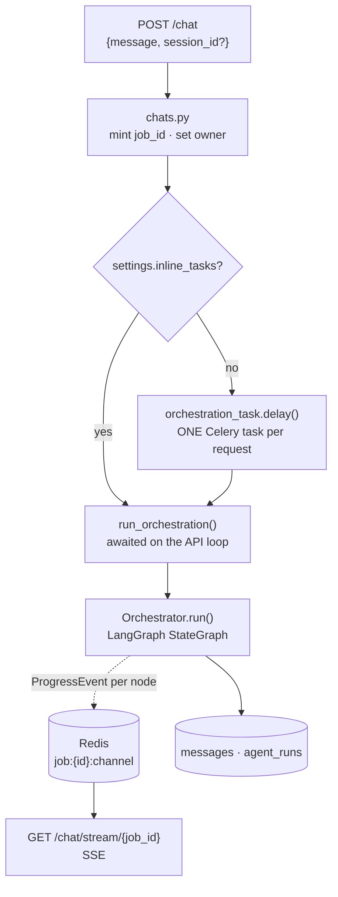
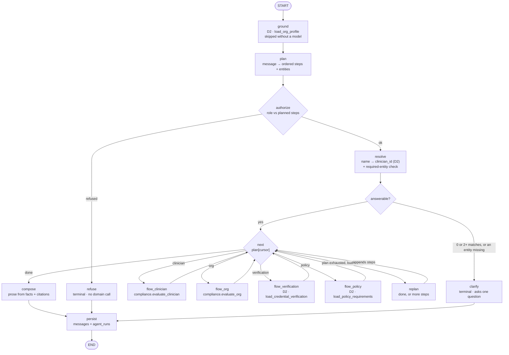
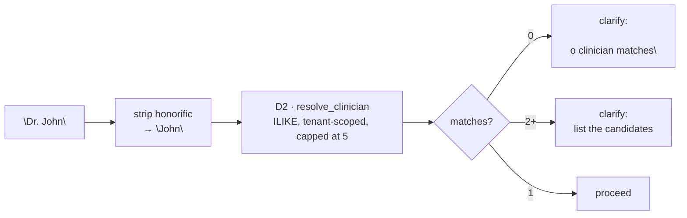
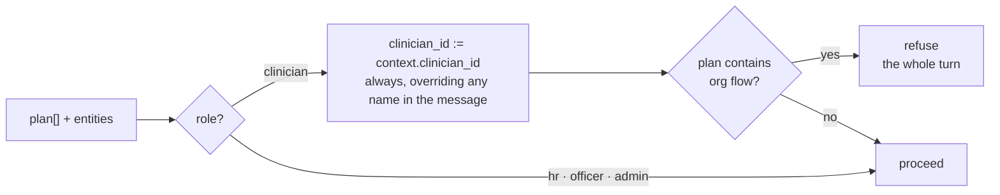
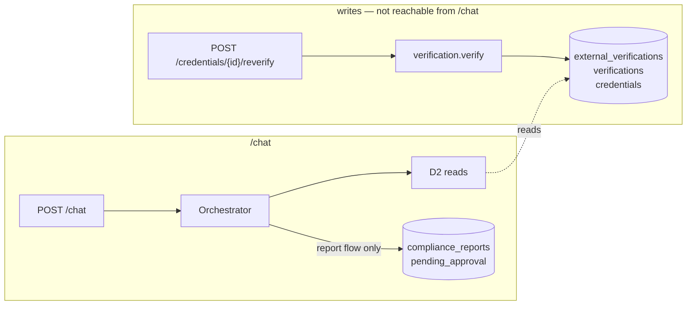
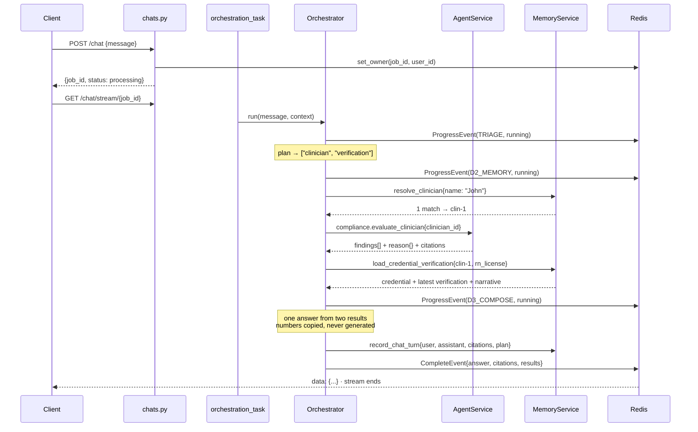

# `/chat` — the D3 orchestration loop

How a sentence becomes a capability call, and how the answer gets back.

`POST /chat` is the platform's **Category A** surface ([architecture.md](../architecture.md) §6): an
open-ended question, answered by whichever agents the question needs, streamed back over SSE. This
document is the spec for what sits between the HTTP route and the three agents in
[AGENTS.md](AGENTS.md).

Three questions it has to answer, taken from
[PROJECT_OBJECTIVE.md](PROJECT_OBJECTIVE.md) §3:

- *"Is this nursing license expired?"*
- *"Compare the uploaded certificate with government records."*
- *"Show missing credentials for Dr. John."*

---

## 1. What the orchestrator is, and is not

**It is not a fifth agent.** The four agents in [AGENTS.md](AGENTS.md) are units of work behind
`CapabilityDef`s, addressed as `"<agent>.<capability>"`. The orchestrator sits *above* them and calls
them through `AgentService` exactly as a Celery task does. It declares no capabilities, is not
addressable through `invoke`, and adds no new route to D4.

One Celery task runs the *entire* loop, however many domain calls it takes — individual domain calls
are never separate jobs. That exists purely to avoid HTTP timeouts on a long chain, and it is why the
route answers with a `job_id` rather than an answer.

---

## 2. Planning: bounded, and allowed to revise itself

[architecture.md](../architecture.md) §2 describes D3 as a "plan → call domains → verify → reflect
loop". Taken literally that is a ReAct agent: the model picks the next capability, reads the result,
decides whether it is done, and loops.

This implementation is **most** of that, with the parts that make a ReAct agent unauditable removed.
The plan is not fixed before the first read any more — "who is non-compliant, and why did each one
fail?" is one question, and answering it means letting the roster rollup decide which clinicians get
read next. But the model still chooses only from a fixed set of flows, and the whole loop is bounded.

| | Static routing | **This** | Full reflect loop |
|---|---|---|---|
| Model calls per turn | 2 | **2–4** | 3–6+ |
| Compound questions | no | **yes** | yes |
| A result can change the plan | no | **yes** | yes |
| Same path every run | yes | **no** — see below | no |
| Runs with `AGENT_TIER=deterministic` | yes | **yes** | no |
| Reachable domains | static | **static** | runtime property |

The two rows that still say "yes" are the load-bearing ones:

**Reachable domains stay static.** Re-planning picks from the flows compiled into the
graph — and from fewer than the initial plan may, since `report` is excluded from it entirely (§8).
A model can only ever ask for work the graph already knows how to do, so `CapabilityDef.calls`
— the mechanism that makes "the Compliance Agent never calls D4" a runtime check rather than a
comment — keeps meaning what it meant.

**The no-model path is unchanged.** `replan` is skipped entirely under `AGENT_TIER=deterministic`,
so the hermetic path executes exactly the plan the keyword matcher produced, exactly as before.

**"Same path every run" is what was traded away**, and it is replaced rather than abandoned. Every
revision is recorded in `agent_runs.input.plan_history` — what was appended, what was dropped and
why, and which result triggered it. A compliance answer still has to be defensible months later; the
defence is now a record of how the plan evolved rather than a guarantee that it did not.

The bounds that keep it from running away:

| Bound | Value |
|---|---|
| Flows in the initial plan | 3 (`MAX_FLOWS`) |
| Flow executions per turn | 6 (`MAX_STEPS`) |
| Re-plan model calls per turn | 2 (`MAX_REPLANS`) |
| A `(flow, args)` pair already read | dropped |
| A re-planned step naming a clinician no result mentioned | dropped |
| A re-planned step a role may not reach | dropped, silently |

`replan` is asked only once the plan is **exhausted**, never between two planned steps: a two-flow
plan runs both and is then asked once whether that was everything, rather than being asked after
each. There is no way to know a question is finished without asking, so a model-backed turn costs
3 calls where it used to cost 2 — plan, one re-plan that answers "done", and compose. The ceiling is
4 (`MAX_REPLANS` is 2, and the second only happens if the first appended work).

---

## 3. The graph

`next` is a conditional edge reading `plan[cursor]`. Each flow node appends its result, increments
the cursor, and edges back. When the cursor runs off the end, `replan` is asked whether the question
is answered; if it appends steps, the same loop picks them up. **That loop is the whole of the
"planning"** — it can only ever reach nodes compiled into the graph, which is what keeps the
reachable domain set static even though the plan is not fixed.

A plan is a list of **steps**, not flow names: `{"flow": "clinician", "args": {...}}`. `args` is
empty for a planned step, which reads the entities resolved once for the whole turn, and populated
for a re-planned one, which has to say who it is about. Two `clinician` steps that differ only in
`clinician_id` are how a drill-down works. `turn["plan"]` still reports flow names — the arguments
live in `plan_history`, which is where anyone asking at that level of detail is already looking.

This is the one graph in the codebase that needs an `Annotated` reducer. The Document, Verification
and Compliance graphs all note that every node writes its own keys, so LangGraph's default merge is
already correct. Here `results` genuinely accumulates across flows, so it takes an append reducer.

---

## 4. Question shapes and flows

Seven question shapes, five flows. Three of the shapes differ only in which slice of the findings the
composer speaks to, so the expensive call happens once and `focus` selects from it.

| Question shape | Example | Flow | `focus` | Underlying call |
|---|---|---|---|---|
| `credential_expiry` | "Is this nursing license expired?" | `clinician` | `expiry` | `compliance.evaluate_clinician` |
| `missing_credentials` | "Show missing credentials for Dr. John" | `clinician` | `missing` | same |
| `clinician_status` | "Is Dr. John compliant?" | `clinician` | `all` | same |
| `source_comparison` | "Compare the certificate with government records" | `verification` | — | D2 `load_credential_verification` |
| `org_status` | "How many nurses are non-compliant?" | `org` | — | `compliance.evaluate_org` · **HR+ only** |
| `policy_lookup` | "What does policy require for a nurse in CA?" | `policy` | — | D2 `load_policy_requirements` |
| `report_request` | "Generate a compliance report for Dr. John" | `report` | — | `report.draft` · **`compliance:report` only** · §8 |

`report` is the only one of these that is not a question, and the only flow that writes. A named
person scopes the report to them, a question naming nobody scopes it to the roster — which is the one
place a missing name is an answer rather than a clarification.

Anything else ends as a **question back**, not a statement — see §6. It used to end as a plain
assertion of what the system could do, which told the user about the system rather than asking them
about their question.

### `focus` is a list

One sentence can ask for two slices. *"Show missing credentials **and** expired licence for Priya
Sharma"* is two questions, both served by one `clinician` call — and answering only the first
silently drops a fact that was already computed and sitting in the findings.

So `focus` carries every slice the question named, and the keyword planner keeps matching after it
has settled the flow rather than stopping at the first hit. `all` is the superset, so a plan naming
it beside anything else collapses to it.

| `focus` | Finding states it selects |
|---|---|
| `missing` | `missing` |
| `expiry` | `expired`, `expiring_soon` |
| `all` | every finding |

The same rule does **not** apply to flows: a flow may appear only once in a plan, because two
identical reads are a planner artifact rather than two questions. Two *slices* of one read are not.

### The plan is sanitised before it is trusted

A model naming a flow that does not exist, or listing six of them, must never reach the graph:

- **at most 3 flows** — a longer plan is truncated, not executed
- **each flow at most once** — a repeat is a planner artifact, not two questions
- **unknown flow name → dropped**
- **empty after filtering → `unsupported`**

---

## 5. Where the model is used, and where it is not

| Node | Tier | Job |
|---|---|---|
| `plan` | `fast` | sentence → `{plan[], focus[], entities…, clarifying_question?}` |
| `replan` | `fast` | question + facts so far → `done`, or more steps |
| `compose` | `deep` | fact sheet → one paragraph |

`plan` and `replan` are both given the domain **vocabulary** — the credential types with a gloss
each, the clinical roles, that `jurisdiction` is a two-letter state code, and which credential types
have no issuing authority at all. It is generated from the enums (`planning.VOCABULARY`), so a member
added by migration cannot go undescribed.

`plan` and `replan` also see the **org profile** from `ground`: which roles this organization's
approved policy covers, which credential types it requires, and how many active rules there are.
Zero active rules is the case that otherwise produces a confidently vacuous *"no requirements apply.
Compliant overall: True"*, so the planner is told about it explicitly. The profile carries no
clinician-identifying data, and it is deliberately **not** given to `compose` — the composer may
state only what is in the fact sheet, and this is not in it.

`replan` is handed the same fact sheet `compose` gets, built by the same `_facts()` helper, so it
inherits the guarantee that a model never sees raw rows.

Tiers, not vendors: which vendor serves `fast` and `deep` is configured per tier and neither node
knows or cares — see [LLM_PROVIDERS.md](LLM_PROVIDERS.md).

**Every number, date, state and citation in an answer comes from a domain call.** The model phrases
facts it did not compute — the same rule `verification.explain` and `report.draft` follow, and the
reason the report and the dashboard cannot disagree. `compose` is handed a fact sheet built in
Python, never raw rows, and its citations are copied from the domain response verbatim: it has no
mechanism for inventing one.

### Both nodes must work with no model at all

[config.py](../app/config.py) defaults `agent_tier` to `deterministic`, in which
`ModelRouter.structured()` returns `(None, 0)` and makes no API call. That is the mode the whole test
suite runs in. So:

- `plan` falls back to **keyword matching**, producing a single-flow plan
  (`"missing"` / `"don't have"` → clinician+missing, `"expired"` / `"expire"` → clinician+expiry,
  `"compare"` / `"match"` / `"government"` → verification, …)
- `compose` falls back to a **template per flow**
- `ground` makes no call — the keyword planner cannot read prose, so grounding it would buy a
  database round trip for nothing
- `replan` never runs, so the plan the keyword matcher produced is the plan that executes

Clarification is the exception that still works without a model, because every case that raises one
is structural rather than linguistic: no rule matched, or a named flow has no value for something it
requires. A model writes a better sentence; the *decision* to ask does not need one.

An answer is always present and always cited. This is the same discipline as D4's sandbox adapters:
the hermetic path is a first-class path, not a degraded one. Low model confidence falls back to the
same keywords rather than guessing.

---

## 6. Identity — resolving "Dr. John"

D2 returns the list; the **orchestrator** decides that 0 or 2+ is a clarify. Ambiguity ends the turn
with the candidates named, because a confident compliance answer about the wrong clinician is a
failure that never surfaces — worse than no answer.

### Asking about anything else

Identity used to be the only thing the turn knew how to ask about. It is now one of four:

| Raised by | When | Example |
|---|---|---|
| `plan` | no flow could be named | *"…Which of those did you mean?"* |
| `plan` | the model was unsure and keywords found nothing either | its own wording |
| `resolve` | a named flow has no value for an entity it requires | *"Which clinical role did you mean — nurse, physician, technician, therapist or pharmacist?"* |
| `resolve` | 0 or 2+ name matches | the candidates, listed |
| `replan` | only the user can supply what is missing | appended to the answer |

`REQUIRED_ENTITIES` declares what each flow cannot run without — today, `policy` needs a `role`.
Checked in `resolve`, so an unanswerable question costs no database read. That replaced a soft
failure inside `flow_policy` which came back as *"Not available: no clinical role named"*, reading
like a system fault rather than a missing detail.

**Precedence.** `refusal` outranks a question: a refused role is told no, not invited to rephrase. A
usable plan outranks a question the model also asked, or asking becomes a way to avoid work the
system could have done. And a question raised **after** a flow has run — only `replan` can do that —
is appended to the composed answer rather than replacing it, because discarding reads already paid
for in order to ask something is worse than answering partially and saying what is still needed.

---

## 7. RBAC

The route only enqueues a job, so `authorize` is the gate — and it runs **on the plan**, before any
flow executes, so a refusal costs no domain call.

Because `replan` can append steps *after* that gate, the check is a pure helper —
`planning.forbidden(role, steps)` — called from both places. A gate that only ran in the first would
be one a re-planned `org` step walked straight past. `authorize` refuses the turn; `replan` drops the
step silently, because the user never asked for it and a refusal would describe a question nobody
put.

Two rules, both from [PROJECT_OBJECTIVE.md](PROJECT_OBJECTIVE.md) §5.1:

- **A clinician login is always answered about itself.** "Show missing credentials for Dr. John"
  asked by a clinician is answered about *them* — the entity in the message never widens their scope.
- **A plan containing the `org` flow is refused whole**, not silently trimmed. A clinician has no
  org-wide view, "not a filtered one, not their own row", and half-answering would hide that the
  question was rejected.

This is permission layer 1 of [architecture.md](../architecture.md) §5. Layer 2 — D2 filtering every
row by `context["org_id"]` — sits underneath it unchanged, and is what stops one org's data reaching
another's.

---

## 8. A question changes nothing; a request to write one thing writes it

Every flow is a **read** except `report`. `source_comparison` reports the `verifications` row the
Verification Agent already wrote — including the narrative it generated at the time — and names the
re-verify action when that judgment is stale. It does not call the registry.

Two reasons for the rule. A question is not an instruction, so a phrasing of "compare these" should
not append an evidence row and update `credentials.status`. And it is the same rule the Compliance
Agent already holds to — *"it never triggers a re-check"* — for the same reason: without it, a chat
surface HR uses casually becomes a source of hundreds of registry calls.

### The one exception, and why it is bounded rather than trusted

"Generate a compliance report for the nursing staff" is not a question, and answering it with a
description of how to generate one would be pedantry. So `report` is a flow — the only one that
leaves a row behind. It is on `planning.WRITES`, which is what buys it three guards:

- **RBAC before the first domain call.** `forbidden()` refuses it to any role without
  `compliance:report` — `admin` and `compliance_officer` hold it; HR, which reads compliance
  perfectly legitimately, does not. That check used to run only for clinician logins, because the
  only restricted flow was `org` and HR may read that; it now runs for every role.
- **`replan` has no word for it.** `REPLAN_SCHEMA`'s flow enum excludes it and `sanitise_replan`
  treats it as an unknown flow, so a plan can acquire a report only because a person asked for one —
  never because a model, reasoning over facts it just gathered, decided one would be useful.
- **It stops at `pending_approval`.** The Report Agent declares no `send` capability, so nothing
  reachable from `/chat` can approve or deliver what it wrote. `compose` is told to say so, and the
  fact sheet says it too, so the deterministic path makes the same claim the model does.

The planner is told to name it only when the question asks in so many words for a report to be
written, and the keyword fallback requires a verb of authorship beside the noun — *"report on her
status"* is a question about her status, and a keyword rule that filed a document for it would be
the worst kind of surprise.

---

## 9. What is streamed, and when

`ProgressEvent.detail` is a **hand-written label** — "looking up the clinician" — never domain
output. Only `CompleteEvent` carries a payload, and only at the end. Nothing on the wire before that
point has passed an egress mask, which is the rule
[verification_task.py](../app/tasks/verification_task.py) already follows.

A node raising `DomainError` is caught at the top of `Orchestrator.run()` and published as an
`ErrorEvent` with a safe message — never a stack trace, per the `ErrorEvent` docstring in
[event_types.py](../app/events/event_types.py).

> **Egress note.** The composed answer names licence numbers and holder names. That is the point of
> the answer, and it reaches only a caller D5 already authorized and D2 already tenant-filtered — but
> it means this payload is exactly what D5's egress mask must wrap when that layer lands.

---

## 10. What gets persisted

Three tables that exist in the schema today and have never been written to:

| Table | Row |
|---|---|
| `conversation_sessions` | One per chat session; created on the first turn when no `session_id` is sent |
| `messages` | Two per turn — the user's and the assistant's. `messages.citations` is where the citations live |
| `agent_runs` | One per turn. `input` records **the plan**, `output` the composed answer, plus tokens/latency |

Written by a single D2 action, `record_chat_turn`, in **one transaction** — the same reason
`record_verification` writes its three tables together. `agent_runs.id` is what finally populates the
`messages.agent_run_id` FK, which is NULL everywhere today.

A `refuse` and a `clarify` are persisted like any other turn. A refusal that leaves no record is not
an audit trail.

---

## 11. New D2 actions

All tenant-scoped from `context["org_id"]`, like every existing handler.

| Action | In | Out |
|---|---|---|
| `resolve_clinician` | `{name}` | `{matches: [{id, full_name, role, jurisdiction}]}`, capped at 5 |
| `load_credential_verification` | `{clinician_id, credential_type}` | credential + latest `verifications` + latest `external_verifications` |
| `load_policy_requirements` | `{role, jurisdiction}` | the active requirement set with citations |
| `load_org_profile` | `{}` | `{roles_with_rules, credential_types_required, jurisdictions, roster_size, active_rule_count}` |
| `record_chat_turn` | session, both messages, citations, plan | `{session_id, message_ids, agent_run_id}` |

`load_org_profile` is a projection of the same `_active_requirements` call plus a roster count, and
it names no clinician — it exists to ground the *planner*, which is choosing a query rather than
stating a fact. It is read once per turn and only when a model will run.

`load_policy_requirements` writes no new resolution logic: it goes straight through the existing
`_active_requirements` + `_resolve_for` pair in [d2_memory/service.py](../app/d2_memory/service.py),
where the specific-shadows-universal precedence already lives. `load_credential_verification` reuses
the `DISTINCT ON (credential_id) … ORDER BY created_at DESC, id DESC` pattern from
`load_compliance_context`.

**No D1.** `app/d1_rag/` is an empty package. `policy_lookup` answers from
`credential_requirements.citation_text` — policy spans a compliance officer personally approved —
not from a vector search that does not exist yet. When D1 lands, it becomes a fifth flow rather than
a change to any of these four.

---

## 12. Related documents

- [AGENTS.md](AGENTS.md) — the three agents this loop calls, and what each must never do.
- [architecture.md](../architecture.md) — the five domains, the `invoke` contract, §6's Category A/B split.
- [REDIS_PUBSUB_EVENTS.md](REDIS_PUBSUB_EVENTS.md) — the event/SSE plumbing this publishes into.
- [PROJECT_OBJECTIVE.md](PROJECT_OBJECTIVE.md) — §3 for what `/chat` is for, §5.1 for the role rules.
