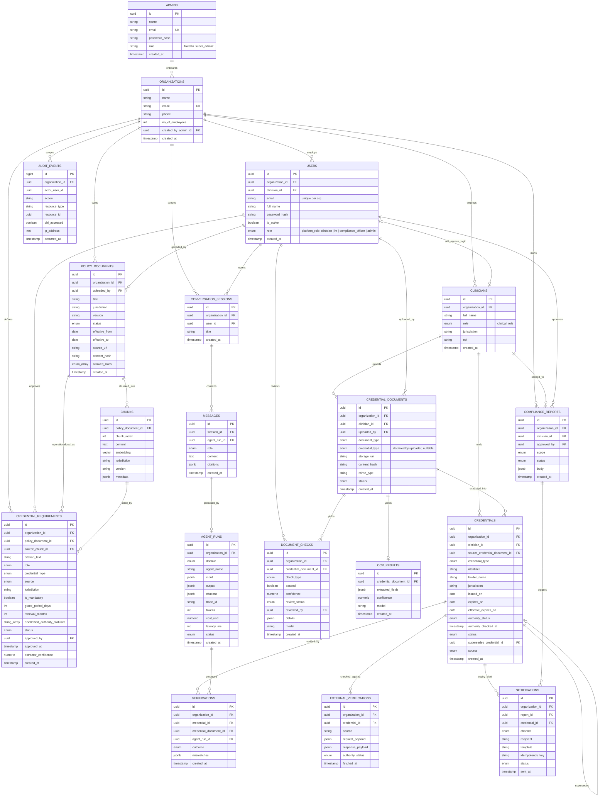

## POC 2 · migration delta against the existing ERD

> Historical record of the POC 2 delta. The diagram above is the authoritative
> schema. Note: the `external_verifications.authority_status_raw` and
> `degraded` columns below were never applied — they exist only in this note.

### 12 columns, 1 constraint, 2 indexes. No new tables, nothing dropped.

BEGIN;

### 1. Policy documents: draft -> published gate.

### Nothing is retrievable and no requirement is active until published.

ALTER TABLE policy_documents
ADD COLUMN status text NOT NULL DEFAULT 'draft'
CHECK (status IN ('draft','published','superseded')),
ADD COLUMN created_at timestamptz NOT NULL DEFAULT now();

### 2. Credential requirements: the compliance-officer review gate,

### plus the two fields verification actually needs.

ALTER TABLE credential_requirements
ADD COLUMN renewal_months int, -- BLS prints no expiry date
ADD COLUMN disallowed_authority_statuses text[]
DEFAULT '{probationary,restricted,suspended,lapsed,revoked}',
ADD COLUMN status text NOT NULL DEFAULT 'pending'
CHECK (status IN ('pending','active','rejected')),
ADD COLUMN approved_by uuid REFERENCES users(id),
ADD COLUMN approved_at timestamptz,
ADD COLUMN extractor_confidence numeric, -- sorts the review table
ADD COLUMN created_at timestamptz NOT NULL DEFAULT now();

### An active rule always has a person behind it. With AUTO_PUBLISH_RULES=true

### pass a system user id, so the shortcut is visible in the data.

ALTER TABLE credential_requirements
ADD CONSTRAINT active_requires_approver
CHECK (status <> 'active' OR approved_by IS NOT NULL);

### Stops duplicate extractions stacking up in the review table.

CREATE UNIQUE INDEX one_active_requirement
ON credential_requirements (organization_id, role, credential_type, jurisdiction)
WHERE status = 'active';

### 3. Credentials: derived expiry. expires_on stays as-printed so a

### disagreement between printed and derived is visible, not overwritten.

ALTER TABLE credentials
ADD COLUMN effective_expires_on date;

CREATE INDEX credential_expiry_scan
ON credentials (organization_id, effective_expires_on)
WHERE status IN ('verified','expiring_soon');

### 4. External verifications: verbatim board string beside the canonical enum,

### and an explicit degraded flag. Unreachable after retries is not verified.

ALTER TABLE external_verifications
ADD COLUMN authority_status_raw text,
ADD COLUMN degraded boolean NOT NULL DEFAULT false;

COMMIT;
