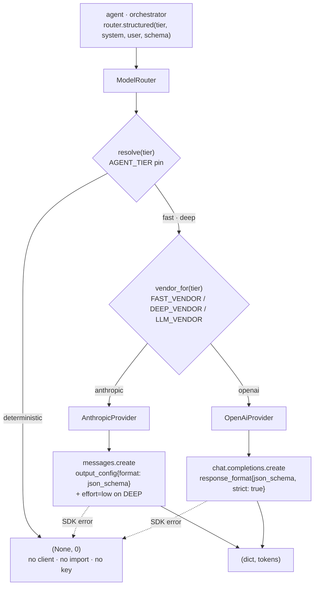
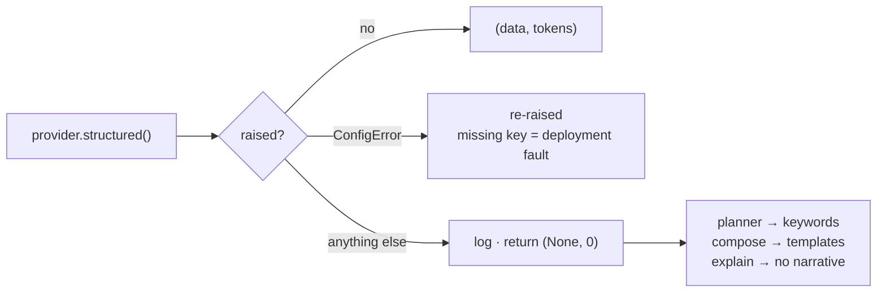

# LLM providers — switching vendors under D3

Every model call in this system goes through one method. This document is about what sits under it.

`ModelRouter.structured()` ([model_router.py](../app/d3_agents/model_router.py)) has five call sites —
`document.classify`, `document.reconcile`, `verification.explain`, and the orchestrator's `plan` and
`compose`. It is the only way out to a model, and there is no free-text path: everything an agent
asks for has a known answer shape.

That chokepoint used to be Anthropic-specific. It is now a **dispatcher**: resolve the tier, resolve
who serves that tier, hand off to a provider that owns the vendor's wire shape.

---

## 1. Two independent axes

**Tier** says how much thinking a capability needs. **Vendor** says who does it. A capability
declares only its tier and never learns who answered — which is what lets you move `deep` from one
vendor to another without touching an agent.



**`resolve()` runs before vendor selection, and that order is load-bearing.** Under
`AGENT_TIER=deterministic` nothing is constructed, no SDK is imported and no key is read. That is
what keeps the whole test suite hermetic, and `test_deterministic_builds_no_provider_at_all` asserts
it directly.

---

## 2. Settings

```
AGENT_TIER=deterministic        # the global pin — overrides every tier below

LLM_VENDOR=anthropic            # default vendor for every tier
FAST_VENDOR=                    # optional override; empty = LLM_VENDOR
DEEP_VENDOR=

ANTHROPIC_API_KEY=
ANTHROPIC_MODEL_FAST=claude-haiku-4-5
ANTHROPIC_MODEL_DEEP=claude-opus-5

OPENAI_API_KEY=
OPENAI_MODEL_FAST=gpt-4.1-mini
OPENAI_MODEL_DEEP=gpt-4.1
```

The global-default-plus-per-tier-override shape is the same one D4 uses for connectors: one
`LLM_VENDOR` the way there is one `GOVERNMENT_API_MODE`, overridable where it matters. Only the keys
for vendors actually in use are needed — a deployment running entirely on one vendor never touches
the other's package.

> **Migration.** `MODEL_FAST` / `MODEL_DEEP` are gone, replaced by the per-vendor pairs — one generic
> name cannot mean two vendors' models at once. `extra="ignore"` in `Settings` means a stale entry in
> a local `.env` is dropped silently rather than crashing, so rename them by hand.

Mixing vendors across tiers is a supported, tested configuration:

```
LLM_VENDOR=anthropic
DEEP_VENDOR=openai
```

→ `classify` and `plan` run on Haiku; `reconcile`, `explain` and `compose` run on GPT.

---

## 3. What each provider owns

`app/d3_agents/providers/` — the D4 `adapters/` + `factory.py` analogue.

| File | Holds |
|---|---|
| `__init__.py` | the `LlmProvider` Protocol and `build_provider(vendor, settings)` |
| `anthropic_provider.py` | Anthropic's request shape, response walk, token sum |
| `openai_provider.py` | OpenAI's |

Suffixed filenames so a module never shadows the SDK package it imports, matching D4's
`real_adapter.py` / `sandbox_adapter.py`.

The contract is two methods:

```python
def model_for(self, tier) -> str
async def structured(self, tier, *, system, user, schema, max_tokens) -> tuple[dict | None, int]
```

### The differences the boundary absorbs

|  | Anthropic | OpenAI |
|---|---|---|
| entry point | `messages.create` | `chat.completions.create` |
| system prompt | its own `system=` parameter | a `{"role": "system"}` message |
| token budget | `max_tokens` | `max_completion_tokens` |
| schema | `output_config={"format": {"type": "json_schema", "schema": …}}` | `response_format={"type": "json_schema", "json_schema": {name, schema, strict}}` |
| reasoning knob | `effort="low"` on DEEP | none in this shape |
| answer | first `text` block in `content[]` | `choices[0].message.content` |
| refusal | `stop_reason == "refusal"`, detail on `stop_details` | `choices[0].message.refusal` |
| tokens | `usage.input_tokens + output_tokens` | `usage.prompt_tokens + completion_tokens` |

**`effort` is the clearest case for the abstraction.** It is an Opus-tier control that Haiku rejects
and that OpenAI has no equivalent for in this shape. It lives in one file, on one branch, and nothing
above the provider knows it exists.

**A refusal is not an error, and both vendors have one.** Either may decline: OpenAI returns
`refusal` in place of `content`, and Anthropic returns `stop_reason: "refusal"` with a category on
`stop_details` — a stop reason that arrived with Opus 4.7, so it applies to the `deep` default here.
Both are "no opinion available", a value every caller in this system already handles, so both come
back as `(None, tokens)`. The tokens are still counted, because they were still billed.

---

## 4. Schemas must be strict

OpenAI only *enforces* a JSON schema in `strict` mode. Strict requires:

- every property listed in `required`
- `additionalProperties: false` on every object, nested ones included

Three of the five schemas already complied. Two did not, and were normalized:

| Schema | Was | Now |
|---|---|---|
| `PLAN_SCHEMA` | `required` named 3 of 7 properties | all 7 — the four entity fields were already typed `["string","null"]`, so a question naming no clinician yields `null` rather than an absent key, which is what `sanitise()` already reads |
| `RECONCILE_SCHEMA` | nested `fields` object had no `required` | `required: list(_FIELD_MAP)` — same nullable-value argument |

Neither change alters what a model can express. They make the shape checkable.

`tests/test_model_router.py` walks **every object node of all five schemas** and asserts both rules.
That test is the point: without it, a future schema edit would keep working on Anthropic and quietly
start failing on OpenAI, and the failure would surface as a degraded answer rather than an error.

---

## 5. When a vendor fails



A rate limit, an outage or a malformed response **costs an answer its prose, never its correctness**.
Every number, date, state and citation in this system is computed by a decision table or copied from
a database column — none of them ever came from a model. So the deterministic fallback is a complete
answer with plainer wording, not a broken one.

Three rules behind that:

- **The broad `except` is deliberate**, and is the only one in D3. The two SDKs raise unrelated
  exception hierarchies, and the caller's contract is already "an opinion may not be available".
- **A missing API key is re-raised as `ConfigError`.** It is a deployment mistake, not a runtime
  condition; degrading would answer everything deterministically and hide that the vendor was never
  reachable at all.
- **No cross-vendor retry.** Answering the same question on a different model depending on who was
  rate-limited would undercut the reproducibility the rest of this codebase is built on — a
  compliance answer has to reproduce months later.

---

## 6. `model_for()`, and why it exists

`document_checks.model` records which model produced a `type_match` check. It used to read
`settings.model_fast` directly, which with per-vendor models would write `claude-haiku-4-5` into a row
GPT actually produced.

That column is audit evidence. Naming a model that did not run is worse than naming none — so the
agent asks the router:

```python
"model": self._router.model_for(ModelTier.FAST),
```

`model_for()` resolves the pin and the vendor exactly as `structured()` does, and returns `None` under
a DETERMINISTIC pin — already the value that column takes for checks with no model behind them.

---

## 7. Adding a third vendor

1. `LlmVendor` gains a member ([config.py](../app/config.py)).
2. Settings gain `<vendor>_api_key` and `<vendor>_model_fast` / `_deep`.
3. A new `providers/<vendor>_provider.py` implements the two methods.
4. `build_provider` gains a branch, with the SDK imported inside it.

Nothing above `ModelRouter` changes — not an agent, not a capability, not a schema.

---

## 8. Related documents

- [AGENTS.md](AGENTS.md) — §8 model tiers, and what each agent uses a model for.
- [CHAT_ORCHESTRATION.md](CHAT_ORCHESTRATION.md) — the two calls `/chat` makes, and its fallbacks.
- [architecture.md](../architecture.md) — the domain boundaries this sits inside.
