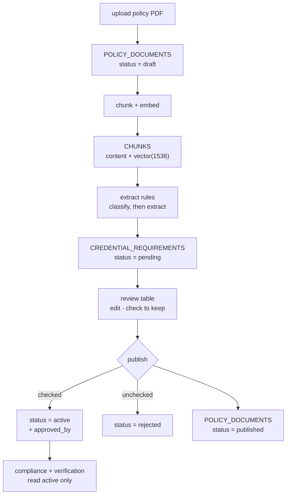

# Policy ingestion — how a PDF becomes an enforceable requirement

A policy document enters the system as a file and leaves it as rows in
`credential_requirements` at `status='active'` — each one carrying the verbatim policy span it came
from, and each one approved by a named compliance officer.

Nothing else in the platform enforces anything. The compliance query reads
`credential_requirements WHERE status = 'active'`, and that `WHERE` clause is the whole of the
enforcement. A rule that no officer has accepted is invisible to it, which is why gap analysis
returns nothing before the first policy is published — the correct answer, and the same empty state
the system starts in anyway.

This document is the spec for D1. **None of it is implemented.**
[`POST /policies/upload`](../app/api/routes/policies.py) exists and returns `501`.

---

## 1. The flow at a glance



Two properties of this shape are load-bearing:

- **Publish is one action, not two.** Checking rows and publishing the document happen on one screen,
  in one transaction. There is no state in which half a policy is live.
- **Unchecked rows become `rejected`, not deleted.** One extra state, and it preserves what the
  extractor proposed against what the officer refused. That is the only evaluation signal for prompt
  iteration you get for free — deleting throws it away.

---

## 2. The steps

### 2.1 Upload and store

`save(content)` in [core/storage.py](../app/core/storage.py) returns `(storage_uri, content_hash)`
and is content-addressed, so re-uploading identical bytes writes the same file. Insert
`policy_documents` with `status='draft'`.

Re-upload of the same bytes into the same organization is the same document —
`uq_policy_documents_org_hash` says so. Reuse the row rather than erroring, exactly as
[`upload_document`](../app/api/routes/documents.py) does for credential documents.

`allowed_roles` is set here. It is the permission-aware retrieval filter: a policy whose
`allowed_roles` excludes the caller's role is filtered out **before** its text can reach a model's
context, rather than being retrieved and then redacted. Empty means no restriction beyond the tenant.

### 2.2 Chunk

Split the document text and insert `chunks` rows with `chunk_index` and `content`.

Copy `jurisdiction` and `version` down from the parent document. Those columns are denormalised on
`chunks` on purpose — a retrieval filter should not need the join.

### 2.3 Embed

Write `chunks.embedding`, `Vector(1536)`. The dimension is `EMBEDDING_DIM` in
[db/models/policy.py](../app/db/models/policy.py); changing it is a migration *and* a re-index of
every chunk.

There is no ANN index on `embedding` yet, deliberately — IVFFlat and HNSW both need list/probe sizing
that means nothing without data behind it. Add one in a follow-up migration once there is a corpus.

### 2.4 Extract rules — two passes

**Pass one, cheap.** Per chunk: *does this state a credential requirement?* Yes or no, no structured
output, `fast` tier. Its only job is to shrink the set the expensive pass sees. Most of a policy
document is definitions, preamble and procedure.

**Pass two, structured.** On the survivors only, `deep` tier with a JSON schema. The extractor must
return a `citation_text` that appears **verbatim in the chunk it was given** — check it, and reject
the extraction if it does not. A paraphrased citation is worse than no citation: it looks like
evidence and cannot be traced back to the policy.

Writes `credential_requirements` at `status='pending'` with `source='policy_document'`,
`policy_document_id`, `source_chunk_id`, `citation_text`, and `extractor_confidence` (which exists to
sort the review queue least-confident-first).

### 2.5 Review

The officer's screen. See §3.

### 2.6 Publish

One transaction:

| | |
|---|---|
| checked rows | `status='active'`, `approved_by=<officer>`, `approved_at=now()` |
| unchecked rows | `status='rejected'` |
| the document | `policy_documents.status='published'` |

`ck_credential_requirements_active_requires_approver` (`status <> 'active' OR approved_by IS NOT
NULL`) makes officer approval the only legal route to active. The extractor cannot self-approve, and
this is enforced by the database rather than by convention.

---

## 3. The review table

Every column is an existing column on `credential_requirements`. Nothing needs adding.

| ✓ | Credential | Role | Jurisdiction | Mandatory | Renewal (mo) | Disallowed statuses | Cited text |
|---|---|---|---|---|---|---|---|
| ☑ | `rn_license` | nurse | US-CA | yes | 24 | probationary, restricted, lapsed | "Required for every clinician in an RN role" |
| ☑ | `bls` | nurse | — | yes | 24 | — | "BLS certification current within 24 months" |
| ☐ | `rn_license` | — | — | yes | — | — | "Issued by the State board of nursing" |

| Column | Source | Editable |
|---|---|---|
| ✓ | not stored — drives the publish action | — |
| Credential | `credential_type` | yes |
| Role | `role` | yes |
| Jurisdiction | `jurisdiction` | yes |
| Mandatory | `is_mandatory` | yes |
| Renewal (mo) | `renewal_months` | **yes — see below** |
| Disallowed statuses | `disallowed_authority_statuses` | **yes — see below** |
| Cited text | `citation_text` | no |

**`citation_text` belongs in the table, not behind a click.** It is what makes review possible at a
glance rather than a row at a time, and it is already a column.

**`renewal_months` and `disallowed_authority_statuses` are the two cells that most need an officer's
eye.** Both change what Verification concludes, and the model is weakest exactly there:

- `renewal_months` is what `credentials.effective_expires_on` is derived from when a credential
  prints no expiry date at all — a BLS card, typically. Without it such a credential has no expiry
  and never comes up for renewal. A model asked for the interval hedges ("typically 24 months") and
  should not be trusted to commit the number.
- `disallowed_authority_statuses` is matched against the verbatim string the issuing board returns.
  It is `text[]` and not an enum array precisely because boards use words our `AuthorityStatus` enum
  deliberately does not carry. Default is
  `{probationary, restricted, suspended, lapsed, revoked}`. Without it, a licence that is
  restricted but not expired passes on its printed date.

**The third row is the point of the gate.** "Issued by the State board of nursing" is an
issuing-authority statement, not a requirement — a real extraction artifact, and the kind a
classifier will keep producing. The officer unchecking it is the thirty seconds of value the review
provides, and because it lands as `rejected` rather than being deleted, the extractor's mistake stays
visible for the next prompt revision.

---

## 4. What each step writes

| Step | Table | Key columns |
|---|---|---|
| 1 Upload | `policy_documents` | `title`, `content_hash`, `source_uri`, `allowed_roles`, `status='draft'` |
| 2 Chunk | `chunks` | `chunk_index`, `content`, `jurisdiction`, `version` |
| 3 Embed | `chunks` | `embedding` — `Vector(1536)` |
| 4 Extract | `credential_requirements` | `status='pending'`, `citation_text`, `source_chunk_id`, `extractor_confidence` |
| 6 Publish | `credential_requirements` | `status='active'\|'rejected'`, `approved_by`, `approved_at` |
| 6 Publish | `policy_documents` | `status='published'` |

Step 5 writes nothing but officer edits to the pending rows.

---

## 5. Where it plugs in

| Seam | State |
|---|---|
| [`POST /policies/upload`](../app/api/routes/policies.py) | exists, returns 501, signature settled |
| `app/d1_rag/` | empty package — no service, no chunker, no embeddings client |
| `EventStep.D1_RAG` | already declared in [events/event_types.py](../app/events/event_types.py), unused |
| `celery_app.py` `include=[...]` | a new task module must be added to that list — discovery is explicit, not autodiscovery |
| Embedding client | none installed; there is no embedding SDK in `pyproject.toml` and no embedding settings in `config.py` |

Patterns worth copying rather than reinventing:

- **The invoke contract.** A `RagService` implementing `DomainService` should dispatch the way
  [`MemoryService`](../app/d2_memory/service.py) does — `getattr(self, f"_handle_{action}")`, typed
  errors converted to `InvokeResponse(ok=False)` rather than raised across the boundary.
- **The pipeline task.** [`document_pipeline_task.py`](../app/tasks/document_pipeline_task.py) is the
  template: a sync Celery entry point wrapping `asyncio.run()`, the real work in an `async def
  run_<x>_pipeline` the API can `await` directly under `settings.inline_tasks`, and every resource
  created and closed per run.
- **Progress events.** `ProgressEvent.detail` is a hand-written label, never extracted data —
  nothing has passed an egress mask at that point. Policy text is the same kind of payload OCR
  fields are.

---

## 6. Known gaps

Two things this flow needs that the schema does not yet support. Both are cheap; both are decisions
for whoever builds the review screen.

### `role = *` is not representable

`credential_requirements.role` is `NOT NULL` over `clinical_role`, which has no "any" member —
it is `nurse | physician | technician | therapist | pharmacist | other`. So the third row of the
table in §3, a rule that applies to every role, cannot be written.

**Recommendation: make `role` nullable, NULL meaning "every role".** That is already exactly what
`jurisdiction` NULL means, so it costs one `ALTER COLUMN` and introduces no new concept. Adding an
`any` enum member instead needs a hand-written `ALTER TYPE ... ADD VALUE` and leaves two ways to
spell the same thing.

### `one_active_requirement` does not stop the duplicate it was written to stop

```sql
CREATE UNIQUE INDEX one_active_requirement ON credential_requirements
  (organization_id, role, credential_type, jurisdiction) WHERE status = 'active';
```

PostgreSQL treats NULLs as **distinct** in a unique index by default. `jurisdiction` is nullable, so
two active `rn_license / nurse / NULL` rules coexist happily — and if `role` becomes nullable per the
gap above, the hole widens. Publishing two policies that state the same requirement would silently
double-count it.

**The fix is one clause**, available because the image is `pgvector/pgvector:pg16`:

```sql
CREATE UNIQUE INDEX one_active_requirement ON credential_requirements
  (organization_id, role, credential_type, jurisdiction)
  NULLS NOT DISTINCT WHERE status = 'active';
```

Note that this makes publish able to fail on a genuine conflict, which is correct — the review screen
has to supersede the existing active rule rather than insert alongside it.

### `AUTO_PUBLISH_RULES` does not exist

[DB_ERD.md](DB_ERD.md) §"POC 2 delta" mentions an `AUTO_PUBLISH_RULES=true` environment flag for
skipping the review gate in a demo. It is not in `app/config.py` or `.env.example` and has never been
implemented. Either build it — passing a system user id, so the shortcut is visible in the data
rather than hidden in a config — or drop the mention.

---

## 7. Related documents

- [PROJECT_OBJECTIVE.md](PROJECT_OBJECTIVE.md) — why requirements must come from cited policy text
  rather than model memory.
- [AGENTS.md](AGENTS.md) — the Compliance Agent, which consumes what this flow produces. Note it
  reads requirements through D2 and never re-retrieves from D1.
- [DB_ERD.md](DB_ERD.md) — `policy_documents`, `chunks` and `credential_requirements` in full.
- [architecture.md](../architecture.md) — the five domains and the `invoke` contract D1 implements.
